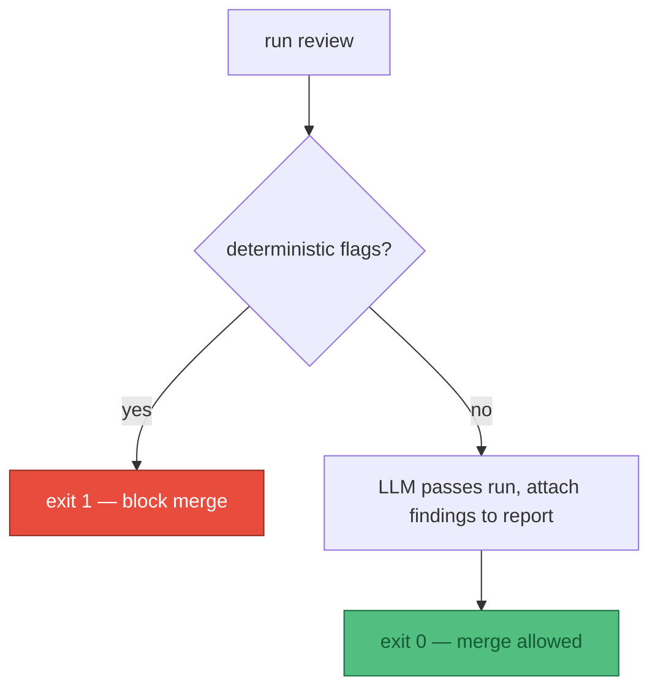

# ADR 0006: Exit codes as the CI contract

Status: Proposed (2026-08-16)

This Architecture Decision Record (ADR) settles the **exit-code contract** the reviewer presents to continuous integration (CI). The whole point of pulling this out of a skill and into a command-line interface (CLI) is that CI can gate on it — and gating requires a stable number the CI runner can branch on without parsing prose. The exit codes *are* the CI contract, so they are one decision, recorded here together.

:::info Parked — L4 detail
This is an **L4** decision (how the built tool behaves), deliberately downstream of the
[design](/concept/approach). It presupposes choices we have not made yet — is this even a CLI, does
it run in CI or by hand? It is recorded so the thinking is not lost, not because it is settled.
:::

## Context

CI cannot read a findings table. To gate a merge it needs a single integer to switch on, with a meaning that never shifts under it. Without a fixed contract every CI config would have to scrape stdout, and any wording change in the report would silently break the gate. We also need CI to distinguish *the docs are wrong* from *the reviewer is wrong* — the same failing exit code for both would send the wrong person to investigate.

## Decision

Adopt a fixed, four-value exit-code contract. The number is the whole interface; the report text is for humans and never load-bearing for the gate.

| Code | Meaning | CI behaviour |
|---|---|---|
| `0` | Clean — no flags from any pass that ran | Merge allowed |
| `1` | Flags found — at least one deterministic check failed | **Block the merge** |
| `2` | Usage / configuration error (bad flag, missing built output) | Fail the job, fix the invocation |
| `3` | Internal / tool error (lychee crashed, browser wouldn't launch) | Fail the job, investigate the tool |

The split between `1` and `3` is the load-bearing part: `1` means *the docs are wrong*, `3` means *the reviewer is wrong*. CI should treat them differently — `1` is a content author's problem, `3` is a maintainer's.

### What gates, and what doesn't

Only the **deterministic** passes contribute to exit code `1`. The LLM (large language model) passes (visual judgment, soft-404 tier-3) produce findings but **do not** fail CI on their own, because they're non-deterministic, and hard-gating on a stochastic verdict is a mistake. They surface as report output a human reviews.

### Output modes

- **Human (default):** a findings table grouped by pass.
- **`--json`:** machine-readable findings for the CI runner or downstream tooling.

## Consequences

CI gets a stable integer to branch on and never has to parse prose, so report wording can change freely without breaking any gate. The `1` vs `3` split routes failures to the right owner automatically — content authors fix their docs, maintainers fix the tool. Keeping the LLM passes out of the hard gate means CI stays deterministic: a merge is never blocked by a stochastic verdict, though those findings still reach a human via the report.

The cost is discipline: every pass must map its outcome onto exactly one of these four codes, and new passes have to declare whether they are deterministic (eligible to raise `1`) or advisory (report-only). Because this is an L4 decision, the contract stays *proposed* until the tool is actually run in CI and the codes are exercised end to end.
