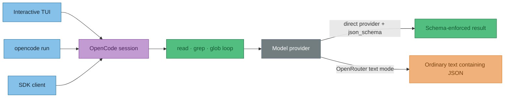

# ADR 0007: OpenCode review modes and structured output

Status: Accepted (2026-08-30)

:::info Decision in one minute
Use **full OpenCode** when recall matters and **controlled OpenCode** when bounded work matters.

Prefer OpenCode's direct providers with API-level JSON Schema output. OpenRouter can run an agent very quickly, but in our tests it returned ordinary text instead of `structured_output`. A locally validated text-JSON fallback remains exploratory.

:::

## The shape of a review



:::tip What the experiments established
The Software Development Kit (SDK) was not adding minutes of overhead. Session creation took **71ms**, and thirty filesystem tools took **732ms**. Almost all elapsed time was model inference between tool rounds.

:::

## Decision

| Need | Use | Boundary |
|---|---|---|
| Highest adaptive recall | **Full `opencode`** | The prompt suggests limits; the agent may exceed them. |
| Predictable work | **`controlled`** | Go enforces searches, snippets, evidence reads and exactly three model calls. |
| No-spend integration canary | **Ollama** | The local model must still prove context capacity and schema compliance. |
| Fast OpenRouter experiment | **Text JSON + local validation** | Not provider-enforced structured output; not yet the production default. |

Use an `opencode-go/...` model for the OpenCode Go subscription. The similar-looking `opencode/...` prefix is the separate Zen pay-as-you-go provider.

:::warning Does not mean

- `opencode run --format json` does **not** constrain the model to a JSON response. It serialises OpenCode lifecycle events.
- A model producing JSON-looking text does **not** prove support for OpenCode's `json_schema` output contract.
- A fast run does **not** prove good findings. Output quality and transport compliance are separate checks.

:::

## How each path was invoked

All controls reviewed `10-decision-tree-cap-clean.md`. The copy-paste prompt is on the [OpenCode playground page](/spec/opencode-prompt).

### Production: API-level structured output

The Go CLI creates an OpenCode session. Its request includes a JSON Schema generated from the Go `MdResponse` structs:

```bash
go run . opencode \
  -model opencode-go/kimi-k3 \
  -url http://127.0.0.1:4097 \
  -timeout 8m \
  -verbose \
  docs/page.md
```

```ts
format: {
  type: "json_schema",
  schema: generatedMdResponseSchema,
  retryCount: 1,
}
```

The result must arrive in `info.structured_output`; Go then unmarshals and validates it.

### Non-interactive OpenCode CLI

`--attach` reuses the server already listening on port 4097 instead of starting another embedded server:

```bash
opencode run \
  --attach http://127.0.0.1:4097 \
  --dir /path/to/repository \
  --model openrouter/qwen/qwen3-coder-next \
  --format json \
  "$PROMPT"
```

This emits `tool_use`, `step_finish` and final `text` events. Automation must select and validate the final text event.

### SDK text-output control

This called the same server but deliberately omitted `format`:

```ts
await client.session.prompt({
  sessionID,
  directory,
  model: { providerID: "openrouter", modelID: "qwen/qwen3-coder-next" },
  tools: {
    read: true, grep: true, glob: true,
    bash: false, edit: false, write: false,
  },
  parts: [{ type: "text", text: prompt }],
})
```

The throwaway control extracted a fenced JSON block—or the outermost object—and unmarshalled it locally. This is weaker than provider-enforced structured output, but stronger than trusting arbitrary prose.

## Results at a glance

### Structured review controls

| Harness and model | Time | Schema | NANC probe | Outcome |
|---|---:|---|---|---|
| Full OpenCode · Kimi K3 | 4m25s | Valid | Found | Five supported findings. |
| Controlled · Kimi K3 | 3m59s | Valid | Found | Five supported findings; first run also transcribed 21 images. |
| Controlled · DeepSeek V4 Flash | 3m18s | Valid | Missed | Three supported findings. |
| Controlled · Ollama Qwen3 30B | 3m23s | Invalid | Not reached | Failed during search-pattern output. |
| Controlled · Ollama GPT-OSS 20B | 2m16s | Invalid | Not reached | Answered target prose instead of the schema. |

The recall probe was `NANC ~29% in 2024` versus `26.8%` in the dedicated backtest page.

### Fast OpenRouter text controls

| Invocation | Time | Agent work | Final context | Returned |
|---|---:|---|---:|---|
| Interactive terminal user interface (TUI) | 22.1s | Not captured | About 52K | JSON-looking text. |
| `opencode run --attach` | 32.2s | 23 tools · 6 turns | 56,852 | Directly parseable JSON text. |
| TypeScript SDK without `format` | 42.18s | 30 tools · 7 turns | 109,936 | Prose plus fenced JSON. |

:::tip Why did the SDK run have twice the context?
It chose **23 reads**, compared with **11 reads** in the CLI run. Every tool result joins the continuing conversation. The SDK did not duplicate the prompt; the agent followed a larger search path.

These figures describe each final model turn—not cumulative token use.

:::

:::warning The prompt did not enforce the tool budget
The prompt asked for at most five greps and five evidence reads. The CLI used 23 tools; the SDK used 30. Full agent limits are guidance. Controlled mode is required when limits must be real.

:::

## What the fast runs returned

These are model claims, not accepted repository corrections. Full results are expandable so timing and quality can be audited without making the page a wall of JSON.

| Run | Headline output | Quality concern |
|---|---|---|
| Interactive TUI | Smart Insider, FiscalNote, Stotles and Tussell | Duplicated Smart Insider and called supporting FiscalNote evidence contradictory. |
| CLI attach | Helio, Smart Insider, disclosure scope, PDMR and terminology | Missed NANC; some evidence mixes politicians with corporate insiders. |
| SDK text | Smart Insider, FiscalNote, market size, revenue path and D6 | Added prose despite “JSON only”; several comparisons are weakly scoped. |

:::details Interactive TUI — condensed returned result

```json
{
  "results": [{
    "id": 0,
    "name": "10-decision-tree-cap-clean.md",
    "success": false,
    "errors": [
      {
        "category": "CONTRADICTS_PAGE",
        "notes": "Smart Insider's ~$872k 2026 estimate appears only in the target; other pages say only sub-£1M."
      },
      {
        "category": "UNVERIFIABLE",
        "notes": "The same Smart Insider estimate has no repository citation."
      },
      {
        "category": "CONTRADICTS_PAGE",
        "notes": "FiscalNote did not buy Dods, but the cited evidence also treats them as separate—so it actually supports the target."
      },
      {
        "category": "UNVERIFIABLE",
        "notes": "The $13M Stotles Series A breakdown is not supported by the comparison page's $21.6M total."
      },
      {
        "category": "UNVERIFIABLE",
        "notes": "The exact $1.36M single-angel Tussell claim is not supported by pages describing it as bootstrapped or approximately $1.4M."
      }
    ]
  }]
}
```

:::

:::details `opencode run --attach` — condensed returned result

```json
{
  "results": [{
    "id": 0,
    "name": "10-decision-tree-cap-clean.md",
    "success": false,
    "errors": [
      {
        "category": "STALE_REF",
        "notes": "The DeHavilland/Helio and NewsDirect timeline differs from docs 12 and 13."
      },
      {
        "category": "UNVERIFIABLE",
        "notes": "Other pages support only sub-£1M, not Smart Insider's exact ~$872k estimate."
      },
      {
        "category": "WRONG_CLAIM",
        "notes": "The no-international-analogue claim conflicts with European and UK PDMR disclosure pages, although politician and corporate-insider scope may be mixed."
      },
      {
        "category": "ACRONYM_UNEXPANDED",
        "notes": "PDMR is not expanded in the decision-tree context."
      },
      {
        "category": "INCONSISTENT_TERM",
        "notes": "The page risks conflating PDMR-regulated people with the RNS reporting mechanism."
      }
    ]
  }]
}
```

:::

:::details TypeScript SDK without `format` — condensed returned result

The assistant added a prose introduction despite the “JSON only” instruction, then returned:

```json
{
  "results": [{
    "id": 0,
    "name": "10-decision-tree-cap-clean.md",
    "success": false,
    "errors": [
      {
        "category": "UNVERIFIABLE",
        "notes": "Smart Insider's exact ~$872k estimate is weaker than the repository's broader sub-£1M description."
      },
      {
        "category": "STALE_REF",
        "notes": "The cited Vuelio and Dragonfly Eye evidence does not establish that 'FiscalNote did not buy Dods' is stale."
      },
      {
        "category": "CONTRADICTS_PAGE",
        "notes": "Stockopedia and SharePad include director-dealing features, though this may not contradict the narrower pure-play market claim."
      },
      {
        "category": "UNVERIFIABLE",
        "notes": "The £5–15M annual recurring revenue path and £30M+ European option lack support from pages describing weak D6 demand."
      },
      {
        "category": "INCONSISTENT_TERM",
        "notes": "D6 is used for both an eventual graph and something resembling a minimum viable product."
      }
    ]
  }]
}
```

:::

## Provider findings

### OpenRouter

OpenRouter Qwen was fast at the ordinary tool loop. The same route did not populate `structured_output` when OpenCode requested `json_schema`. This is an output-protocol failure, not an inability to generate JSON text. LiteLLM remains excluded because it also failed to preserve the structured-output contract.

### OpenCode Go, Zen and Ollama

OpenCode's direct providers produced valid structured output in successful Kimi and DeepSeek runs. An `opencode/gemini-3.6-flash` attempt failed before inference because the Zen workspace lacked pay-as-you-go credit.

:::details Why the local Ollama runs failed

OpenCode advertised 32K context, but `ollama ps` showed GPT-OSS 20B loaded on `desktop-work` with only 4,096 tokens. The response reported exactly 4,096 input tokens. Once the target, instructions and schema filled the window, the model answered content embedded in the target.

Ollama needs a larger server default or an alias with `PARAMETER num_ctx 32768`. Even at 4K, GPT-OSS 20B took about thirty seconds to answer a greeting, so this host is underpowered for production 20B/30B reviews. It remains useful for no-cost integration canaries.

:::

```bash
OPENCODE_OLLAMA_INTEGRATION=1 \
OPENCODE_OLLAMA_MODEL=ollama/gpt-oss:20b \
OPENCODE_URL=http://127.0.0.1:4097 \
go test ./internal/opencodereview -run TestOllamaIntegration -v
```

## Images and whole-site reviews

Images are shared preprocessing: SVG source becomes text; PNG, JPEG and WebP use the vision model. Transcriptions are cached by absolute path and SHA-256 content hash. Remote HTTP(S) images remain deferred.


Review each changed page in an isolated, resumable session against bounded evidence. Make one final synthesis call over compact findings—not all raw Markdown.

## Consequences

- ✓ Direct OpenCode providers remain the trusted structured-output path.
- ✓ Full and controlled modes cover adaptive recall and enforceable bounds.
- ✓ OpenRouter text JSON is a measured fallback candidate, not an unexplained failure.
- ✓ Logs must record tools, model turns, final context, parse behaviour and recall probes.
- ✗ Prompted limits are not guarantees in full agent mode.
- ✗ Local parsing cannot make text equivalent to provider-enforced JSON Schema.
- ✗ `desktop-work` is not currently a production host for these 20B/30B reviews.
