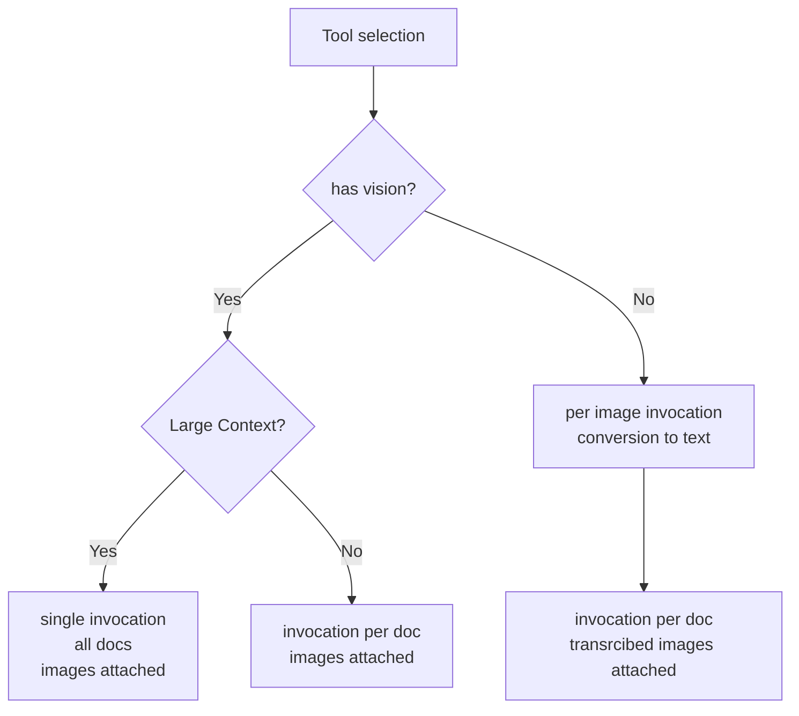
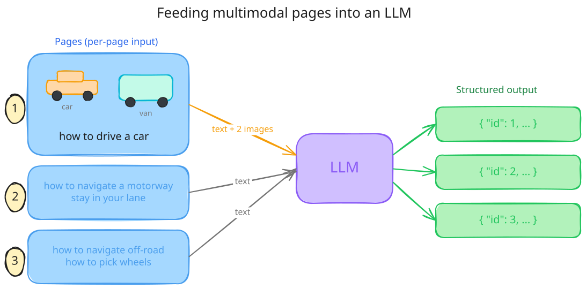
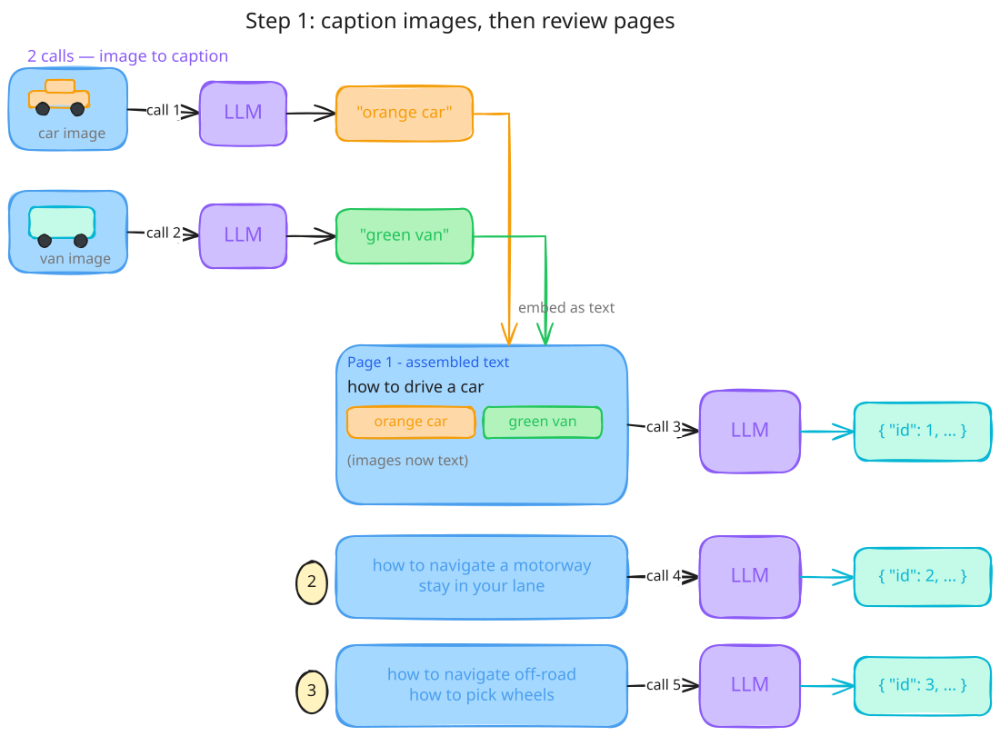

# Approach

## Review approaches

| Approach | Description | Pros | Cons |
|---|---|---|---|
| Batch | Send all files in one API call. | Simple; the model sees every file directly. | Results degrade as the corpus grows and relevant facts are diluted. |
| Dependency | Summarise files and hand-roll dependency resolution before reviewing each target. | Most control over dependency selection and context size. | Brittle; summaries are lossy and dependency resolution can miss the right evidence. |
| OpenCode | Use an agent harness to find and read dependencies for each target. | The agent can search the corpus and choose full files with its own tools. | Less deterministic and relies on an external tool. |

## Model Selection

The [spec](/spec/reference) says *what* to catch. This is *how*

Firstly, the invocation on the tool depends on the model used to detect failures

### Single invocation

If you're fine burning through frontier model (gemini/claude) credits, the entire content and images can be passed into the model

This is by far the simplest approach, but requires a vision + text model and a large context window (large enough to process all data in one go)

### Multiple invocation

For local models, a dependency tree is built such that each document can be processed individially, thus enabling smaller models to be able to process large documentation sets. For models lacking vision, a separate model is needed to convert the image to text for the model to judge failures as an additional step

Thus the process becomes 

## Workflow
