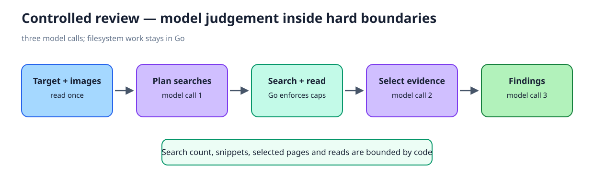
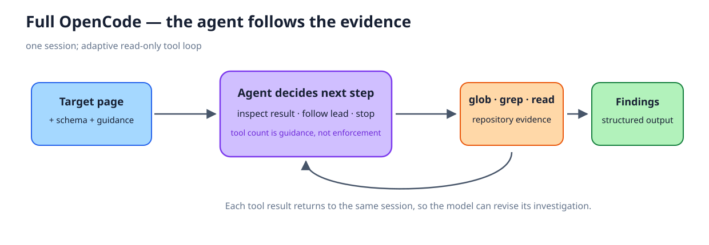
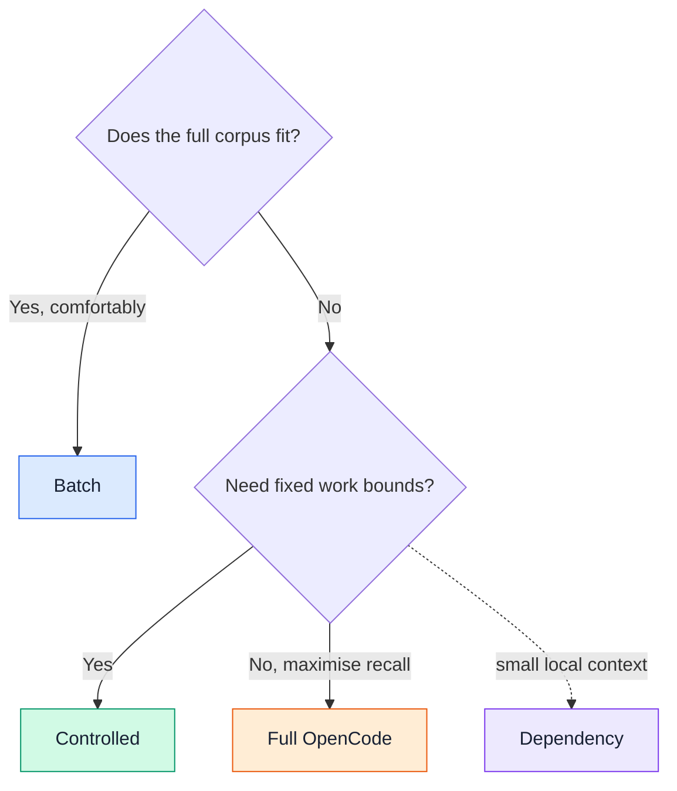
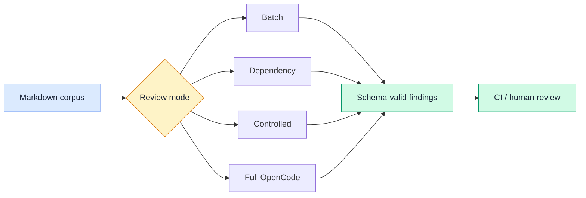

import { ReviewModeCards, ControlledPipeline, ImagePipeline } from '../../components/ReviewApproaches';

# Pick the review shape

There is no universally best harness. Choose how much context, autonomy and cost you are willing to give the model.

<ReviewModeCards />

:::tip Current recommendation
Start with **controlled** for bounded, observable work. Move to **full OpenCode** when recall matters more than predictable runtime. Use **batch** only while the whole corpus genuinely fits.
:::

## See the four pipelines

The same three-page example makes the difference concrete. Blue is repository content, purple is model judgement, orange is image or search work, and green is the result.

### Batch — everything enters one review

### Dependency — summarise and connect before reviewing

### Controlled — let the model choose, let Go enforce

### Full OpenCode — the agent follows its own evidence trail

## Controlled: the middle path

Controlled mode keeps the useful decisions with the model while moving repetition and limits into Go.

<ControlledPipeline />

The full agent can follow unexpected leads. Controlled mode instead guarantees the search and read budgets. That predictability can cost recall: a weaker model once missed a known **29% versus 26.8%** contradiction that a stronger Kimi run found.

## Images are evidence too

Image handling applies across review modes; it is not a separate review strategy.

<ImagePipeline />

- SVG source is transcribed as text.
- PNG, JPEG and WebP go through the configured vision path.
- Target images are available during search planning; selected evidence images reach the final review.
- Remote HTTP(S) images are deferred.

## Choose quickly

| If you care most about… | Choose |
|---|---|
| Minimum machinery | **Batch** |
| Supporting a small-context model | **Dependency** |
| Predictable model calls and filesystem work | **Controlled** |
| Adaptive investigation and recall | **Full OpenCode** |

## Output compliance is a gate

A model being clever is irrelevant if the provider does not return the required schema.

:::warning Provider routes are not interchangeable
The working hosted path uses direct OpenCode providers and a schema generated from the Go response structs. OpenRouter and LiteLLM compatibility routes have not reliably enforced the same structured output. Local Ollama is safe for no-spend integration tests, but each model still has to pass the compliance canary.
:::

Use `opencode-go/...` for the OpenCode Go subscription. `opencode/...` is the separate Zen credit route. See [ADR 0007](/appendix/decisions/0007-review-modes-and-defect-coverage) for commands, measured runs and the provider findings.

## End-to-end workflow

